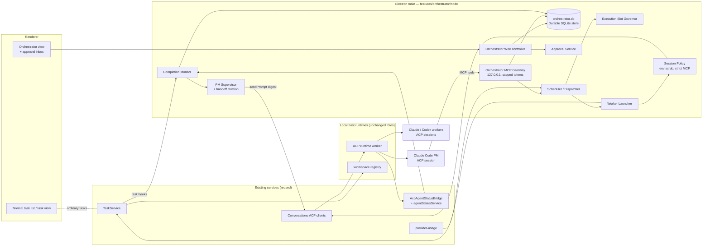
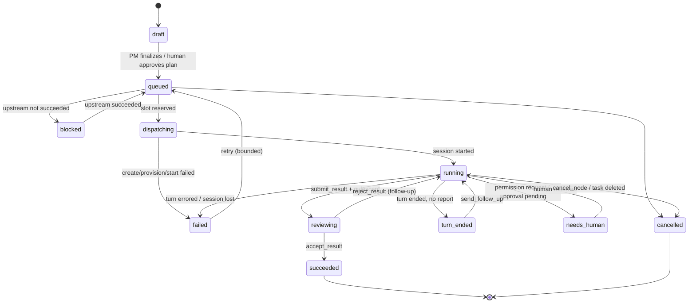

# Orchestrator Mode — Architecture

> **Status: Design approved — implementation not started.** Nothing here exists in the codebase
> yet. Agents working on other areas must not treat this page as a
> description of current behavior. Decision record: [ADR 0009](../adr/0009-orchestrator-mode.md).
> Companion pages: [risks](risks.md), [implementation plan](implementation-plan.md),
> [backlog](backlog.md).

## Decisions Recorded (2026-10-21)

The owner reviewed the proposal and decided:

1. **Concurrency**: hard cap of 5 live agent sessions. Manual sessions count toward the cap; the
   orchestrator stops dispatching at the cap but never blocks a session the user starts.
2. **Hosts**: v1 is local-host only; SSH / workspace-server hosts come later.
3. **Git**: workers may push their own task branches (and open pull requests) using the project's
   normal Git credential settings. **Merges are done by the user on GitHub after review**; Emdash
   and its agents never merge.
4. **Plan review and decisions**: the user reviews the PM's initial plan before workers are
   dispatched. After that, the PM presents findings and decisions as they arise; an open decision
   blocks only the nodes that depend on it, and all other work continues.
5. **Provider terms**: the owner confirmed their Claude and OpenAI plans allow this use.

All app paths are relative to `apps/emdash-desktop/` unless prefixed with `packages/`.

## 1. Goal And Scope

Orchestrator Mode is an **optional, off-by-default** mode in which a Claude Code "PM" agent plans
work, creates worker tasks, dispatches Claude Code and Codex workers, monitors their completion,
and delegates follow-ups — all through Emdash's own task, workspace, and conversation machinery.

Hard requirements (from the request):

| # | Requirement | Where it is satisfied |
| --- | --- | --- |
| R1 | Max 5 concurrent agent executions globally, PM included | §6 Execution Slot Governor |
| R2 | Task dependencies, scheduling, isolated Git worktrees | §5.3 Scheduler, §5.4 Worker Launcher |
| R3 | PM-created tasks are ordinary Emdash tasks | §5.4 (uses `TaskService.createTask`) |
| R4 | PM has scoped task-management tools (MCP) | §7 Orchestrator MCP Gateway |
| R5 | Automatic completion monitoring and follow-up delegation | §5.5 Completion Monitor, §8.3 |
| R6 | Persistent PM state, periodic fresh-session handoffs | §5.6 PM Supervisor, §9 |
| R7 | Human approval for merges, purchases, destructive ops, system changes | §5.7 Approvals and decisions, [risks](risks.md); merges happen on GitHub by the user |
| R8 | Existing Claude Code / Codex subscription auth; no API billing | §5.8 Session Policy |
| R9 | Windows compatibility | [risks §3](risks.md#3-windows-compatibility) |
| R10 | No regressions to normal Emdash | §10 Isolation and feature flag |

### Non-goals for v1

- Remote (SSH / workspace-server) hosts. v1 orchestrates **local-host projects only**; remote
  support is a later phase because it changes where the dispatcher and MCP gateway must run.
- TUI (PTY) workers. v1 workers use ACP Chat sessions because ACP gives structured turn-completion
  evidence, a `sendPrompt` API for follow-ups, and a session summary. TUI support is a later phase.
- Merging, purchasing, or approving ACP permission requests. These remain human actions by
  design; merges happen on GitHub, outside Emdash.
- A second task system. There is no orchestrator-owned "job" table that competes with `tasks`.

## 2. Investigation Summary: What Already Exists

The design is built almost entirely from existing seams. Every row below was read in the current
tree.

| Need | Existing component | Source |
| --- | --- | --- |
| Create an ordinary task + worktree + initial conversation | `TaskService.createTask()` → `prepareCreateTask` / `commitCreateTask` / `finalizeCreateTask`; worktree created through the registry verb in the background | `src/core/features/tasks/api/node/task-service.ts`, `src/core/features/tasks/node/operations/createTask.ts` |
| Task config incl. ACP provider, options, `initialQueue` | `taskConfig` v1 (`initialConversation.type: 'acp'`, `options`, `initialQueue`) | `src/core/primitives/tasks/api/task-config.ts` |
| Activate a task workspace without the renderer | `TaskService.provisionWorkspace(taskId)` (idempotent; awaits pending creation; replays failed creation) | `task-service.ts` |
| Task lifecycle notifications | `TaskLifecycleHooks`: `task:created`, `task:updated`, `task:archived`, `task:deleted`, `task:workspace-ready` | `task-service.ts` |
| Task status shown in the normal UI | `taskList.setStatus` mutation (`todo`, `in_progress`, `review`, `done`, `cancelled`, …) | `src/core/features/tasks/api/wire-contract.ts` |
| Start / resume an ACP session from main | Conversations controller resolves an `acpInput` (provider, cwd, env from `TaskSessionLaunchContextResolver`) then calls `client.acp.startSession({ ...input, mode })` | `src/core/features/conversations/node/wire-controller.ts` (≈ lines 290–330, 420–470) |
| Send follow-up prompts, cancel, terminate | ACP contract `sendPrompt` (`placement: 'auto' \| 'queue'`, client `promptId`), `cancelTurn`, `terminate` (record stays resumable) | `packages/core/src/runtimes/acp/api/contract.ts`, `api/schemas.ts` |
| Turn-completion evidence | `SessionSummary` (`isGenerating`, `lastStopReason`, `lastTurnErrored`, `pendingPermissionCount`, `queuedPromptCount`, `backgroundAgentCount`, `suspended`) | `packages/core/src/runtimes/acp/api/models/session.ts` |
| Desktop-side status projection + event hook | `AcpAgentStatusBridge` observes per-host session summaries → `agentStatusService.applySignal()` → `'agent:event'` hook (already consumed by notifications) | `src/main/core/acp/agent-status-bridge.ts`, `src/main/core/agent-status/agent-status-service.ts` |
| Context-window usage (handoff trigger) | `sessionUsageSchema` (`contextSize`, `contextUsed`, `cost`) | `packages/core/src/runtimes/acp/api/models/config.ts` |
| Subscription quota visibility | `usageLimits` probes for Claude and Codex; `provider-usage` runtime | `packages/plugins/src/agents/impl/{claude,codex}/usage.ts`, `packages/core/src/runtimes/provider-usage/` |
| Per-session MCP servers to the agent | ACP `session/new` / `session/load` already carry `mcpServers`; today they are read from the provider's user-global config only (`agentHost.readMcpServers`) | `packages/core/src/runtimes/acp/node/runtime/session-materializer.ts` (`resolveSessionMcpServers`), `mcp-servers.ts` |
| Loopback server with bearer token pattern | `TuiHookServer` (`127.0.0.1`, ephemeral port, random token, header check) | `packages/core/src/runtimes/tui-agents/node/hooks/hook-server.ts` |
| Separate durable SQLite store with its own migrations | `defineDurableSqliteStore` (used by the automations runtime: own file, backups, invariants) | `packages/core/src/primitives/sqlite-store/`, `packages/core/src/runtimes/automations/node/persistence/store.ts` |
| Headless "create workspace → start session" precedent | Automations runtime: scheduler with `maxConcurrentRuns`, executor, `session-start` port | `packages/core/src/runtimes/automations/node/` |
| Host-unreachable deletion semantics | Tombstones + reconcile sweep (ADR 0006); task creation refuses tombstoned targets | `docs/adr/0006-*.md`, `createTask.ts` |

Two important findings shape the design:

1. **Automations are a precedent, not a vehicle.** Automation runs are host-side records that are
   later *adopted* into tasks (`type: 'automation-run'`, `adoptRun`). Its `maxConcurrentRuns`
   bounds runs *in the start pipeline*; a run is `done` once its session **starts**, not when the
   agent finishes. Neither property fits orchestration, which must create ordinary tasks up front
   and hold a slot until the agent's work is finished. Orchestrator Mode therefore reuses the
   automations *patterns* (separate durable store, executor/port shape, Clock seam) but drives the
   desktop `TaskService` directly.
2. **Provisioning is renderer-driven today.** A created task's workspace is activated when the
   renderer's task manager calls the `workspaces.provision` job. The orchestrator calls the same
   `TaskService.provisionWorkspace()` from main so PM-created tasks run without the user opening
   them; opening one in the UI hits the idempotent fast path.

## 3. Placement Decision

The orchestrator is a **desktop feature slice** that runs in the Electron main process:

```text
apps/emdash-desktop/src/core/features/orchestrator/
  api/            # Wire contract, DTOs, zod schemas, typed client (renderer-safe)
  node/           # store, governor, scheduler, launcher, monitor, PM supervisor,
                  # MCP gateway, approval service, session policy, Wire controller
  browser/        # Orchestrator view, approval inbox, task badges
  contributions/  # browser.ts, views.ts, commands.ts, settings.ts
```

Why not a `packages/core` runtime: tasks, projects, and conversations-to-task links are desktop
entities (see `agents/architecture/state-ownership.md`). A host-side runtime would need the
automations-style adoption dance to create ordinary tasks, and Core runtimes may not depend on each
other. A desktop slice can call `TaskService`, the conversations runtime clients, and the agent
status hooks directly. This is the "application composition" case in
`agents/architecture/core-modules.md` §"Choosing A Module Type".

## 4. Component Overview



## 5. Components

### 5.1 Orchestrator Store (`node/store/`)

A separate durable SQLite file (`<userData>/orchestrator.db`, overridable by
`EMDASH_ORCHESTRATOR_DB_FILE` for tests) created with `defineDurableSqliteStore`, exactly as the
automations runtime does. It holds **orchestration metadata only** and references desktop entities
by id. Tasks, workspaces, and conversations stay in the app DB and remain authoritative.

Using a separate store means **no new Drizzle migrations in the app DB**, which is the single
largest upstream-conflict source in this repo (sequential `drizzle/00NN_*.sql` plus `meta/`).

| Table | Purpose | Key fields |
| --- | --- | --- |
| `orch_runs` | One orchestration (a goal supervised by one PM) | `id`, `projectId`, `goal`, `state`, `pmTaskId`, `policy` (versioned JSON: caps, providers, models), `createdAt`, `revision` |
| `orch_nodes` | One unit of delegated work; 1:1 with an ordinary task once dispatched | `id`, `runId`, `title`, `brief`, `provider` (`claude` \| `codex`), `model`, `effort`, `choiceReason`, `owns` / `readOnly` / `mustNotTouch` (path lists), `options`, `baseFrom` (`default-branch` \| `node:<id>`), `priority`, `state`, `taskId?`, `conversationId?`, `attempt`, `followUps`, `result?` (versioned JSON) |
| `orch_edges` | Dependencies | `runId`, `fromNodeId`, `toNodeId` (to waits on from) |
| `orch_events` | Append-only journal (state transitions, worker reports, PM tool calls, approvals) | `seq`, `runId`, `nodeId?`, `kind`, `payload`, `at` |
| `orch_inbox` | Findings, decisions, and approvals for the human | `id`, `runId`, `type` (`finding` \| `decision` \| `approval`), `kind`, `blocksNodeIds`, `body`, `actionSpec?` (canonical JSON), `actionHash?`, `state` (`open` \| `answered` \| `approved` \| `rejected` \| `expired` \| `executed` \| `failed`), `answer?`, `decidedAt?` |
| `orch_pm_sessions` | PM conversation generations | `runId`, `generation`, `conversationId`, `startedAt`, `endedAt?`, `endReason?` |
| `orch_handoffs` | PM-written handoff memos | `runId`, `generation`, `memo`, `createdAt` |

Rules: one writer (the orchestrator node layer); state transitions go through a transition table
(see §8.1) with a pure fold for UI severity; versioned JSON columns use `defineVersionedSchema()`.
Capability tokens are **never** stored (§7.3).

### 5.2 Execution Slot Governor (`node/governor.ts`)

Enforces R1. See §6 for the counting rule. API:

```ts
interface ExecutionSlotGovernor {
  /** Reserve before provisioning; fails fast when no slot is free. */
  tryReserve(owner: SlotOwner): Result<SlotLease, 'cap-reached' | 'disabled'>;
  /** Live census: orchestrated leases + non-orchestrated live agent sessions. */
  census(): SlotCensus;
  onSlotFreed(listener: () => void): Unsubscribe;
}
```

A `SlotLease` is fenced by a generation number and released only when the Completion Monitor
observes the session suspended/terminated (or the launch fails). Leases are in memory; on restart
they are rebuilt from the census plus `orch_nodes` in `running`/`dispatching` states.

### 5.3 Scheduler / Dispatcher (`node/scheduler.ts`)

- A node is **ready** when its state is `queued` and every upstream node is `succeeded`.
- Ready nodes are ordered by `priority` then creation order.
- Dispatch runs on events (node change, slot freed, approval decided, quota refreshed) plus a
  backstop tick through the `Clock` seam (no raw timers; testable with `createManualClock`).
- Dispatch gates, in order: feature enabled → run `active` → quota headroom for the provider
  (provider-usage probe; configurable threshold) → `governor.tryReserve()`.
- Per-run caps from `policy`: max nodes, max attempts per node, max follow-ups per node, max
  dispatches per hour. Exceeding a cap moves the run to `needs-human` instead of silently stopping.

### 5.4 Worker Launcher (`node/launcher.ts`)

Turns a ready node into an **ordinary task** with no special task type:

1. Build `CreateTaskParams` exactly as the Create Task modal does:
   - `taskConfig`: `name` = node title (validated as a Task name), `initialStatus: 'in_progress'`,
     `initialConversation: { type: 'acp', provider, options, initialQueue: [{ text: brief,
     hiddenContext: workerPreamble }] }`.
   - `workspaceConfig`: `new-worktree` with `git.kind: 'create-branch'`. `fromBranch` is the
     project default branch, or — when `baseFrom = node:<id>` — the upstream node's task branch.
     Linked worktrees share the repository's local refs, so no push is needed to stack work.
   - Branch names go through the existing `resolveTaskBranchName()` prefix rules.
2. `taskService.createTask(params)` — the same call the renderer makes; task shows up in the task
   list immediately; worktree creation runs through the registry verb.
3. `taskService.provisionWorkspace(taskId)` — activates the workspace from main (awaits creation,
   runs `scripts.prepare`).
4. Start the ACP session via the same target resolution the conversations controller uses
   (refactored into a shared function, §10.2) with `mode: 'fresh'`, after the Session Policy
   decorates the input (§5.8).
5. Record `taskId`, `conversationId`, lease generation in `orch_nodes`; emit an `orch_events` row.

Failure at any step releases the lease and moves the node to `failed` with the step name, mirroring
the automations executor's `{ step, code, message }` error shape. Task creation errors such as
`workspace-tombstone-pending` are surfaced verbatim.

### 5.5 Completion Monitor (`node/monitor.ts`)

Wakes on `agentStatusService` `'agent:event'` and on `TaskLifecycleHooks`, then reads the
authoritative ACP `SessionSummary` before acting. It never infers completion from silence or
timers (consistent with "Provider terminal proof" and "Session quiescence" in `CONTEXT.md`).

| Observation | Node outcome |
| --- | --- |
| Worker called `submit_result` (§7.2) and summary is quiescent (`!isGenerating`, `queuedPromptCount = 0`, `pendingPermissionCount = 0`, `backgroundAgentCount = 0`) | `reviewing` → PM is notified |
| Turn ended (`lastStopReason` present, quiescent) without `submit_result` | `turn-ended` → PM is notified with the last assistant message excerpt |
| `pendingPermissionCount > 0` | `needs-human` (permission requests are never auto-resolved) |
| `lastTurnErrored` / session error / `session_not_found` | `failed` (retry is a PM or human decision, bounded by policy) |
| Task archived or deleted by the user | `cancelled`; lease released; dependents become `blocked` |
| No evidence for a long time | Shown as *delayed* in UI only; never changes outcome |

After the PM accepts a result (`accept_result`) the node becomes `succeeded`, the task status is set
to `review` (via the normal `taskList.setStatus` path), and the worker session is **terminated** to
free its slot. `terminate` keeps the conversation record resumable, so the user can reopen and
continue it manually.

### 5.6 PM Supervisor (`node/pm-supervisor.ts`)

- The PM is itself an **ordinary task** named `PM: <goal>` in its own worktree (isolated from the
  main checkout so stray edits are harmless). Its conversation is a Claude Code ACP session.
- The PM's system context is injected as `hiddenContext` on its initial prompt: role, rules
  ("plan and delegate; do not edit code; you cannot merge or delete"), and the current run snapshot.
- **Event digests**: the supervisor batches monitor events and delivers them to the PM with
  `sendPrompt({ placement: 'queue' })`, so a busy PM receives them at its next turn boundary.
  Batching window and max digest size are policy settings (token control).
- **Handoff rotation** (§9) replaces the PM conversation with a fresh one while keeping the same PM
  task, so the task view shows one PM with several conversations over time.

### 5.7 Approvals And Decisions (`node/approvals.ts`)

Two record types share one inbox:

- **Findings** (`record_finding`): informational items the PM surfaces as they arise (risks found,
  scope discoveries, notable results). They never block work.
- **Decisions and approvals** (`request_decision`, `request_approval`): questions or gated actions
  that need the human. Each record lists the node ids it **blocks**. Only those nodes (and their
  dependents) wait; the scheduler keeps dispatching everything else. A record that blocks no node
  is advisory.

Rules for approvals:

- Approval records are created by the PM (`request_approval`), by the orchestrator itself for
  gated actions, or by worker reports.
- An approval is bound to a canonical `actionSpec` and its hash. Executing an approved action
  re-hashes the spec; any change invalidates the approval (same idea as ACP command receipts).
- **Decisions can only be made through the renderer Wire procedure**, never through MCP. No MCP tool
  can approve anything.
- Execution of approved actions is done by Emdash's existing first-party paths, never by handing
  the PM a capability.
- Approval kinds in v1: `destructive` (delete branch/worktree/task, force-push, history rewrite),
  `system-change` (install dependency, change global/provider config), `spend` (any action with
  monetary cost), `cap-raise` (raise run caps), `other`. There is no `merge` kind: merges are the
  user's action on GitHub, and no Emdash tool or approval executes a merge.

### 5.8 Session Policy (`node/session-policy.ts`)

Applied to every orchestrated ACP start input (PM and workers):

- **Subscription-only env scrub**: removes `ANTHROPIC_API_KEY`, `ANTHROPIC_AUTH_TOKEN`,
  `ANTHROPIC_BASE_URL`, `CLAUDE_CODE_USE_BEDROCK`, `CLAUDE_CODE_USE_VERTEX`, `OPENAI_API_KEY`,
  `OPENAI_BASE_URL`, `AZURE_OPENAI_*` (and similar billing-routing variables) from the resolved
  launch env. These are currently allowlisted in `packages/core/src/primitives/agent-env/api/index.ts`
  and passed through when present in the user's shell or project env.
- **Auth preflight**: before a run starts, the provider auth status probe must report an
  authenticated CLI login (not env-key auth). Unknown status blocks the run with a clear message.
- **Strict MCP set**: orchestrated sessions receive only the Orchestrator MCP server plus an explicit
  per-run allowlist — not the user's global MCP set — so connectors with side effects (payments,
  brokerage, email, cloud admin) are not reachable by orchestrated agents. For Claude Code, also
  disable claude.ai-hosted connectors in the session env (to be verified against the installed CLI
  version; see risks).
- **Permission mode**: workers default to the provider's "edits allowed, commands ask" native mode
  (Claude `acceptEdits`, Codex workspace-write/on-request), configurable per run. Dangerous-mode
  options (`bypassPermissions`, `--dangerously-*`) are refused for orchestrated sessions.
- **Git credentials**: orchestrated workers use the project's normal Session Git credential mode,
  so they can push their own task branches and open pull requests. Worker instructions forbid
  merging, force-pushing, and pushing to branches other than their task branch; the robust guard
  against merges is GitHub branch protection on the default branch (preflight checks for it and
  warns when it is absent).

## 6. Concurrency Semantics (R1)

**Definition.** An *agent execution* is a **live provider session**: an ACP conversation that is
materialized and not suspended, or a running TUI agent PTY. Idle-but-live sessions count, because
they hold a provider process and subscription capacity.

**Census.** `census = orchestratedLeases + liveNonOrchestratedSessions`, computed from the same
session-summary live models that `AcpAgentStatusBridge` already observes for the local host, plus
the TUI session list.

**Rule.** The orchestrator dispatches only when `census < 5`. The PM holds one slot for its entire
active life. During handoff rotation the old PM session is terminated *before* the new one starts,
so rotation never overshoots.

**Manual sessions** (decided): user-started sessions are **counted but never blocked**. If the user
starts sessions while 5 are live, the orchestrator simply stops dispatching until the census drops.
The cap is fixed at 5 and cannot be raised above it.

**Reservation before provisioning.** The lease is taken before `createTask`, so five concurrent
provisioning pipelines cannot overshoot when sessions start.

## 7. Orchestrator MCP Gateway (R4)

### 7.1 Transport

- An MCP server hosted in main on `127.0.0.1` with an ephemeral port, following the `TuiHookServer`
  pattern. Streamable HTTP transport. It listens **only while Orchestrator Mode is enabled and at
  least one run is active**.
- Delivered to the agent through ACP `session/new.mcpServers` as an `http` server with an
  `Authorization` header carrying a per-session capability token.
- Fallback for providers whose ACP adapter does not advertise `mcpCapabilities.http`: a tiny stdio
  shim launched as `process.execPath` + `ELECTRON_RUN_AS_NODE=1` (the same pattern the Claude and
  Codex ACP adapters use) that proxies stdio to the loopback endpoint.
- Requests are rejected unless `Host` is `127.0.0.1:<port>`/`localhost:<port>` and the token
  matches (DNS-rebinding defense). No CORS.

### 7.2 Tool Surface

Tools are scoped by the token's **role** and **run**. Every mutating call is journaled.

PM tools (role `pm`, scoped to one run):

| Tool | Effect |
| --- | --- |
| `get_run` | Run snapshot: goal, policy, caps, nodes, edges, slot census, pending approvals |
| `create_node` | Add a work item (title, brief, provider `claude`/`codex`, options, priority, `baseFrom`, dependencies). Validated against caps; does not dispatch by itself |
| `update_node` | Edit a node that has not been dispatched |
| `add_dependency` / `remove_dependency` | Edit edges; cycles rejected |
| `cancel_node` | Cancel a not-yet-dispatched node; for a running node, requests `cancelTurn` + terminate (task and worktree are kept) |
| `send_follow_up` | `sendPrompt({ placement: 'queue' })` to a dispatched worker of this run; bounded by `maxFollowUps` |
| `get_node_result` | Worker report, last assistant message excerpt, changed-line stats, branch name |
| `accept_result` / `reject_result` | Mark `succeeded` (unblocks dependents) or reopen with feedback (counts as a follow-up) |
| `submit_plan` | Present the initial plan (drafts + rationale) for human review |
| `record_finding` | Surface a non-blocking finding to the human |
| `request_decision` | Ask the human a question; lists the node ids it blocks (may be none) |
| `request_approval` | Create an approval record for a gated action; lists blocked nodes. Cannot decide it |
| `write_handoff` | Store the handoff memo for the next PM generation |
| `log_decision` | Append a free-text decision to the journal (shown in the run timeline) |

Worker tools (role `worker`, scoped to exactly one node):

| Tool | Effect |
| --- | --- |
| `submit_result` | Structured report: `status` (`done` \| `blocked` \| `needs-decision`), summary, files touched, tests run, open questions |
| `request_approval` | Ask the human for a gated action (same record type; cannot decide it) |

**Deliberately absent** from every role: merge, delete task/worktree/branch, archive, change
settings, install dependencies, resolve permission requests, decide approvals or decisions, read
other runs, or touch tasks the run did not create. (Workers push their own branches with ordinary
`git`, not through an orchestrator tool.)

### 7.3 Capability Tokens

- 256-bit random tokens minted per `(runId, role, nodeId?, sessionGeneration)` and wrapped in the
  shared `Secret` type; compared in constant time.
- Held **in memory only**; revoked when the session is terminated, rotated, or the app quits. After
  an app restart, tokens are re-minted when sessions are re-materialized.
- The ACP runtime already never persists MCP credentials or provider environment in conversation
  intents (`agents/architecture/acp-runtime.md`); the new per-session field must keep that
  invariant (backlog item ORCH-03 adds a test).

## 8. State Machines And Flows

### 8.1 Node States



Task status mapping (through the normal `taskList.setStatus` path): `dispatching`/`running` →
`in_progress`; `reviewing`/`succeeded` → `review`; `cancelled` → `cancelled`. `done` is left to the
human after merge, so the orchestrator never claims work is merged.

Run states: `planning` → `active` ⇄ `paused` → `completed` | `cancelled`, plus `needs-human`
(cap reached, auth failure, quota exhausted).

### 8.2 Starting A Run

1. User enables Orchestrator Mode (settings), opens the Orchestrator view, picks a project, enters a
   goal and policy (defaults: cap 5, Claude PM model, worker providers allowed).
2. Preflight: local-host project, Claude auth is CLI login, Codex auth if Codex is allowed, quota
   headroom, git remote present (worktrees need one, as for automations).
3. Orchestrator reserves a slot and launches the PM task (§5.6). The run enters `planning`.
4. PM proposes nodes via `create_node` (state `draft`) and calls `submit_plan`. The human
   **reviews the initial plan** (approve, edit, or reject individual nodes) before drafts become
   `queued`.
5. After plan approval, nodes the PM adds later are queued immediately and appear in the run's
   findings feed as plan changes, unless they depend on an open decision.

### 8.3 Completion And Follow-Up

1. Worker finishes a turn → `AcpAgentStatusBridge` emits `stop` → monitor reads summary.
2. Node → `reviewing` (or `turn_ended`); lease kept; event appended.
3. PM Supervisor batches and queues a digest into the PM conversation.
4. PM calls `get_node_result`, then `accept_result`, `reject_result` / `send_follow_up`, or
   `request_approval`.
5. On `accept_result`: node `succeeded`, worker terminated, slot freed, dependents re-evaluated,
   scheduler dispatches the next ready node.

### 8.4 Findings, Decisions, And Approvals

1. `record_finding`, `request_decision`, or `request_approval` creates a record; the run's view
   shows it in the inbox and an OS notification is sent through the existing notification service.
2. Nodes listed as blocked by an open decision/approval move to `blocked`; **every other ready node
   keeps dispatching**. The PM keeps working on unblocked nodes.
3. The human answers or approves/rejects in the renderer. Approved actions execute through the
   first-party service and record `executed`/`failed`; blocked nodes are re-evaluated; the PM
   receives the outcome in its next digest.

### 8.5 Merging

Workers push task branches and may open pull requests. When the PM accepts a node's result, the
task moves to `review`. The user reviews and merges on GitHub. The orchestrator observes merged PRs
through the existing pull-request sync and, if the user wants, sets the task to `done`.

### 8.6 Restart Recovery

- On boot (and only if the mode is enabled), the orchestrator opens its store, rebuilds the census,
  and reconciles each `dispatching`/`running` node against the app DB task and the ACP session list.
- Sessions are **not** auto-resumed by the orchestrator at boot (matches the ACP runtime rule that
  the worker never starts a provider from disk). Runs come back `paused`; the user clicks Resume.
- A node whose task was deleted while the app was closed becomes `cancelled`.

## 9. PM Persistence And Handoffs (R6)

The PM's memory is **not** its context window. The authoritative state is `orch_runs`,
`orch_nodes`, `orch_edges`, `orch_events`, and `orch_inbox`; `get_run` returns a compact,
deterministic snapshot of it.

Rotation triggers (any, evaluated only when the PM session is quiescent — never mid-turn):

- `contextUsed / contextSize ≥ policy.handoffContextRatio` (default 0.6) from `sessionUsage`;
- `policy.maxDigestsPerGeneration` digests processed (default 25);
- `policy.maxGenerationAge` elapsed (default 4 h).

Rotation sequence:

1. Supervisor queues "write your handoff now" to the PM; waits for `write_handoff` + quiescence
   (bounded wait; on timeout the supervisor writes a mechanical handoff from the journal).
2. Terminate the old PM conversation (slot freed, token revoked; record stays resumable for audit).
3. Create a new conversation in the **same PM task** with `initialQueue` = role preamble +
   `get_run` snapshot + latest handoff memo + events since the memo. Mint a new token.
4. Record `orch_pm_sessions` generation `n+1`.

Token cost per generation is bounded by the snapshot size (nodes summarized, journal truncated to
events since the last handoff) rather than by the full history.

## 10. Isolation, Feature Flag, And No-Regression Strategy (R10)

### 10.1 Feature flag

- App setting `orchestrator.enabled` (default `false`) contributed through the slice's
  `contributions/settings.ts`. When false: the store is not opened, the MCP gateway does not
  listen, the governor is inert, the view and commands are hidden, and **no existing code path
  changes behavior**.
- Every change to shared code paths (§10.2) is a no-op unless the caller passes orchestrator-owned
  inputs.

### 10.2 Touch points in existing code

| # | Change | Files | Risk |
| --- | --- | --- | --- |
| T1 | Optional, non-persisted `sessionMcpServers` + `mcpServerMode: 'merge' \| 'only'` on the ACP start input; materializer merges them in `resolveSessionMcpServers` | `packages/core/src/runtimes/acp/api/schemas.ts`, `node/runtime/session-materializer.ts` | **High-risk area** (ACP). Additive optional field = protocol minor; must not be persisted in intents |
| T2 | Extract `resolveConversationRuntimeTarget` into a reusable function and add an optional `decorateAcpInput` hook | `src/core/features/conversations/node/wire-controller.ts` | Medium; pure refactor + optional hook |
| T3 | Read-only census accessor on the ACP bridge (live session summaries per host) | `src/main/core/acp/agent-status-bridge.ts` | Low |
| T4 | Manifest registrations (contract, controller, browser contributions, settings) | `src/core/manifests/**` | Low; append-only lines |
| T5 | Bootstrap wiring of the orchestrator service | `src/main/bootstrap/boot/phases/services.ts` | Low; append-only block |

Everything else is new files under `src/core/features/orchestrator/`.

### 10.3 Test strategy

- Unit tests with `createManualClock` for scheduler, governor, monitor, handoff triggers.
- Store tests use `assertSqliteStoreInvariants` and a temp file.
- Controller/gateway tests: token scoping, Host-header check, tool-by-role matrix, journaling.
- Integration test (main-db project): temp repo + scratch `EMDASH_DB_FILE`, a fake ACP provider
  plugin, full run of 3 nodes with one dependency, cap of 2.
- Regression guard: with `orchestrator.enabled = false`, snapshot that the gateway port is closed,
  no orchestrator store file is created, and the ACP start input passed for a normal task is
  byte-identical to before (T1/T2).
- All manual and automated testing uses a scratch database and scratch repositories; no existing
  user project data (including any existing production project) is read or modified.

## 11. Mirroring The Manual PM Process (D-012)

Orchestrator Mode automates the PM process the owner already uses by hand (Toll's `docs/pm/`, and
this repo's [`docs/pm/PROCESS.md`](../pm/PROCESS.md)). The product keeps the same vocabulary and
the same things the owner looks at, so moving from manual to automated changes who presses
"launch", not what is presented.

| Manual process | Product equivalent |
| --- | --- |
| `BACKLOG.md` board: slots used, running, in review, ready now, queued | Orchestrator view header: census `n / 5`, running nodes, in review, **Next up**, queued |
| Task brief `tasks/T-xxx.md` (paste-ready prompt) | Node `brief`: the exact prompt sent as the worker's initial message, shown verbatim |
| "Suggested agent · Model (effort)" | Node `provider`, `model`, `effort` (native ACP config option ids, from ORCH-25/26) |
| Agent and model guidance tables | Run policy defaults + PM instructions; the PM must give a one-line reason per choice |
| "Owns / Read only / Must not touch" | Node `owns`, `readOnly`, `mustNotTouch` path lists; included in the brief and enforced as a dispatch gate (ORCH-30) |
| Single-owner hotspots | Run policy `hotspots` list; only one running node may own each |
| "Depends on (merged)" | Edges; gate defaults to merged-to-`main` (D-013) |
| `DECISIONS.md` open questions with "Blocks" | Inbox decisions with `blocksNodeIds` (§5.7) |
| Report template `reports/T-xxx.md` | `submit_result` fields: status, summary, changed files, verification, tests, how to check by hand, deviations, blockers and open questions, suggested follow-ups |
| Owner merges on GitHub | Unchanged (D-005) |

### Next up

The **Next up** list shows each ready or queued node as a card with:

- the full prompt (brief), expandable, editable before dispatch;
- agent, model and effort, each a dropdown populated from the discovered provider catalogs, with the
  PM's suggested value and reason;
- owned paths and any overlap or hotspot conflict with running nodes;
- dependencies and blocking decisions;
- actions: **Launch now**, **Hold**, **Edit**, **Cancel**.

During initial plan review every node appears here with **Approve**. After the plan is approved,
ready nodes dispatch automatically as slots free up (D-014); **Launch now** only matters for a run
switched to manual launch, or to start a held node. Queued nodes stay editable until they
dispatch, so the owner sees and can change prompt, agent, model and effort before each task starts,
the same as in the manual process.
